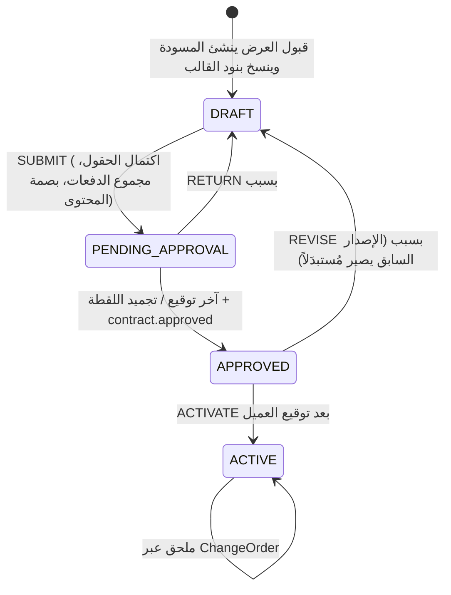

# ADR-01: إصدار «عقد المشروع» PDF من قالب مُدار داخل النظام

> الحالة: **مُقَرّ — أجاب المالك عن الأسئلة الخمسة في 2026-10-12 (القسم 8)** · التاريخ: 2026-10-12
> أعدّه الوكيل المعماري `erp-architect` بقراءة الكود على `feat/copilot@1a4d545` (لا تشغيل). ترقيمه مستقل عن سجل قرارات مَدار (`spec/madar/04-DECISIONS.md`).
> راجعت الجلسة الرئيسية بنفسها: أنواع المستندات الخمسة في المصفوفة (`packages/shared/src/approvals.ts:12-18`)، قيم `ContractStatus` و`ContractType` (`packages/db/prisma/schema.prisma:131-144`)، وأن النسخة المنسّقة المرجعية بخط IBM Plex Sans Arabic ومقاس A4 ومن إنتاج Chrome.

## طلب المالك

«العقود أريد العقد يصدر من النظام بعد الاعتمادات كملف pdf، ويكون متاح التعديل على محتواه وتحديثه من داخل النظام بصلاحية مدير النظام.»

وفي وثيقة دورة التشغيل: «عند موافقة العميل يتم تحويل عرض السعر آلياً على النظام إلى "عقد مشروع"، مع ضبط الشروط المالية والجدول الزمني للدفعات وإمكانية تعديل الشروط»، و«نموذج لعقد بالكامل لرفعه كمسودة على النظام يتحول لعقد بعد اعتماد عرض السعر مع إضافة إمكانية التعديل والحذف والإضافة بالعقد».

## 1. الحالة الراهنة

| الحقيقة | الدليل |
|---|---|
| مسارات الإنشاء ثلاثة: زر يدوي في صفحة العرض بعد القبول (لا تحويل آلي)؛ مَدار من مستند مرفوع؛ عقد الطاقة يُنشأ `ACTIVE` مباشرة. لا زر إنشاء في قائمة العقود | `apps/web/src/app/(app)/proposals/[id]/page.tsx:402,420,460` · `apps/copilot/src/execute/flows/customer_contract.ts:16-21` · `apps/api/src/modules/ppa/ppa.service.ts:84-94` · `apps/web/src/app/(app)/contracts/page.tsx:46,83` |
| الإنشاء من عرض يشترط نسخة `ACCEPTED` ويعلّم الفرصة `WON`؛ يقبل `totalValue` مغايراً للعرض ودفعات لا يُفحص مجموعها | `apps/api/src/modules/commercial/contracts.service.ts:78-82,89,107,125-136` |
| الحالات `DRAFT/ACTIVE/SUSPENDED/CLOSED/CANCELLED`؛ الانتقال الوحيد المبرمج `DRAFT→ACTIVE` بالمفتاح `commercial.contract.write` نفسه الذي يُنشأ به العقد (تحمله المبيعات): لا فصل مهام. لا مسار لتعديل العقد أو دفعاته بعد الإنشاء | `packages/db/prisma/schema.prisma:138-144` · `contracts.service.ts:157-176` · `apps/api/src/modules/commercial/contracts.controller.ts:21-53` · `packages/db/prisma/seed.ts:43` |
| العقد خارج مصفوفة الاعتماد ومحرك سير العمل. المشمول خمسة أنواع آخرها `PROPOSAL`، والاعتماد الوحيد في السلسلة اليوم توقيع الإدارة العليا على كل عرض من صفر ريال | `schema.prisma:2208-2219` · `packages/shared/src/approvals.ts:12-18,35-80` · `packages/shared/src/workflow.ts:17-24` · `packages/db/prisma/migrations/0027_crm_proposals_backfill/migration.sql:36-55` |
| إضافة نوع مستند = قيمة enum بترحيل يسبق أول استخدام + مدخل في `APPROVAL_DOCUMENTS` بمفتاح اعتماد + تسجيل applier/rejecter (وإلا يُرفض الإقلاع) + تدفق سير عمل كبيانات لكل منشأة + منح المفاتيح للأدوار بترحيل، لأن البذرة ليست جزءاً من النشر | `migrations/0026_crm_proposals/migration.sql:15-24` · `0027_crm_proposals_backfill/migration.sql:7-8,57-98` · `apps/api/src/common/approval.service.ts:148-171` · `apps/api/src/modules/commercial/proposals.service.ts:131-137` |
| المصفوفة تفرض: الرافع لا يعتمد، ولا يوقّع شخص خطوتين | `approval.service.ts:339-351` |
| المنشأة: اسم، سجل، رقم ضريبي، عنوان نصي حر، هاتف، بريد، موقع، شعار | `schema.prisma:211-222` · `apps/api/src/modules/admin/dto.ts:126-181` |
| العميل: اسم، سجل، ضريبي، هاتف، جوال، بريد، منشأة/فرد؛ جهات اتصال (اسم، صفة، جوال، بريد، أساسي) | `schema.prisma:422-438,471-482` |
| العرض: رقم وتاريخ؛ النسخة: إجمالي وتواريخ؛ البند: صنف، كمية، سعر؛ الصنف: رمز واسم وفئة ووحدة؛ التصميم: قدرة kWp | `schema.prisma:687-697,706-731,744-753,623-633,668-679` |
| المشروع لا يُنشأ إلا بعد `ACTIVE`، وفيه `siteRef` نصي و`capacityKwp` فقط | `schema.prisma:1207-1223` · `apps/api/src/modules/projects/projects.service.ts:82-84` |
| قيمة العقد ومبلغ الدفعة قبل الضريبة؛ الضريبة تُضاف عند الفوترة | `apps/api/src/modules/finance/invoices.service.ts:143-149` |
| المرفق عام، وحذفه متاح لكل حامل `platform.attachment.write` يقرأ الكيان (ومنهم المبيعات) | `schema.prisma:2146-2172` · `apps/api/src/modules/platform/attachments.service.ts:45-47,168-174` |
| الطباعة الوحيدة من المتصفح، ولا مكتبة PDF في الخادم | `apps/web/src/app/(app)/invoices/[id]/print/page.tsx:3-8` · `apps/api/package.json:13-34` |
| صورة api على `node:20-alpine` بلا `USER` وتحمل `DATABASE_URL` و`JWT_SECRET`؛ النشر يبني على الخادم | `apps/api/Dockerfile:22-41` · `docker-compose.prod.yml:26-43` · `deploy/deploy.sh:178,203-205` |
| النسخ الاحتياطي لا يشمل مجلد `uploads` | `deploy/backup.sh:107-112,126-127,184` |

**ما يحتاجه النموذج ولا حقل له اليوم:** رقم هوية العميل الفرد وعنوانه الوطني (لا حقل عنوان للعميل أصلاً)، ممثل الشركة وصفته، مصنِّع/طراز/مواصفة الصنف، بيانات الموقع (منطقة، إحداثيات، آبار، قدرة المضخات)، تاريخ ومدينة التوقيع، مدة التنفيذ، نسبة الغرامة وسقفها ونسبة الإنهاء، جدول الضمانات، نسبة كل دفعة، المبلغ كتابةً (لا دالة تفقيط في المستودع).

## 2. القرار

**صلبة (لا تُساوَم):**
1. المستند الصادر لقطة مجمَّدة لا تُعدَّل ولا تُحذف. **تعارض مصرَّح:** إن قُصد بالطلب تعديل محتوى عقد صادر في مكانه بصلاحية المدير فهو يكسر قاعدة «المستند المعتمد لا يُعدَّل». البديل: قبل التفعيل إعادة فتح ثم إصدار جديد مرقّم بعد إعادة الاعتماد؛ بعد التفعيل ملحق مستقل مرتبط بـ`ChangeOrder` (`schema.prisma:1451-1473`).
2. بنود القالب تُنسخ إلى العقد عند إنشائه. إصدار القالب المنشور لا يُعدَّل؛ تعديله إصدار جديد لا يمس عقداً قائماً.
3. العقد يدخل المصفوفة (`CONTRACT`) والمحرك. الـPDF يصدر آلياً عند آخر توقيع: اللقطة تُجمَّد داخل معاملة الاعتماد، والتوليد عبر outbox بهوية النظام.
4. أربعة مفاتيح منفصلة: القالب، بيانات العقد، نص بنود العقد، الاعتماد. الرافع لا يعتمد.
5. لا HTML حر: محتوى منظَّم وحقول دمج من قائمة مغلقة.
6. مجموع الدفعات = قيمة العقد شرط للرفع.

**مرنة:** موضع المُصيِّر، الأسماء، ترتيب المهام 3–5، Gotenberg بديلاً للحاوية المبنية.

## 3. التصميم

### البيانات

```sql
ContractTemplate(id, organizationId, code, contractType, nameAr, isDefault, isActive)   -- UNIQUE(org,code)؛ افتراضي واحد لكل نوع (فهرس فريد جزئي)
ContractTemplateVersion(id, templateId, versionNo, status DRAFT|PUBLISHED|RETIRED,
  contentJson, fieldDefsJson, defaultMilestonesJson, contentHash, changeNote, publishedById, publishedAt)
ContractDocumentRevision(id, organizationId, contractId, kind CONTRACT|ADDENDUM, revisionNo,
  templateVersionId, status DRAFT|FROZEN|ISSUED|SUPERSEDED, contentJson, fieldsJson, rowVersion,
  dataSnapshotJson, contentHash, issueNo, frozenAt,
  pdfAttachmentId, pdfSha256, rendererVersion, issuedAt, changeOrderId)
Contract       += templateId, documentSource SYSTEM|EXTERNAL
ContractStatus += PENDING_APPROVAL, APPROVED
Customer += nationalId, addressAr;  Organization += signatoryName, signatoryTitle;  Item += manufacturer, modelNo, specAr
AttachmentEntity += CONTRACT_DOCUMENT   -- نظامي: /attachments يرفض رفعه وحذفه
```

- Trigger يرفض UPDATE/DELETE على إصدار قالب منشور وعلى نسخة مجمَّدة (سابقة: `migrations/0018_pih_chain_structure/migration.sql:42-53`).
- بيانات خاصة بالنوع (موقع، آبار، مدة، غرامة، ضمانات) في `fieldsJson` وفق `fieldDefsJson`؛ المال يبقى Decimal في أعمدته.
- يُعاد استخدام: Attachment للملف، AuditLog، ApprovalRequest/Step، جداول سير العمل، DomainEvent، ContractMilestone، ChangeOrder.

### الدورة ولحظة الإصدار



- المسودة تُنشأ داخل معاملة قبول العرض (`proposals.service.ts:689-703`)، ودفعاتها من افتراضيات القالب (50/30/20)، و`proposalRevisionId @unique` يمنع التكرار (`schema.prisma:783`).
- معالج `contract.approved` يُسجَّل كما في `apps/api/src/modules/procurement/procurement.service.ts:75`؛ يصيّر من اللقطة، يخزّن الملف، يسجّل `pdfSha256`. مفتاحه معرّف النسخة فتكراره لا يُنتج ملفاً ثانياً، وفشله يُعاد بالتراجع المعرَّف (`workflow.ts:201`). التنزيل يخدم الملف المخزَّن ولا يُعاد توليد صادر.
- بصمة المحتوى تُحفظ عند الرفع وتُطابق عند الاعتماد.

### الصلاحيات

| الفعل | المفتاح | الافتراضي |
|---|---|---|
| تحرير ونشر القالب | `admin.contract_template.manage` (جديد) | مدير النظام |
| بيانات العقد ودفعاته والبنود الاختيارية (مسودة) | `commercial.contract.write` | المبيعات |
| تعديل/إضافة/حذف نص بند في عقد | `commercial.contract_clause.write` (جديد) | مدير النظام ومُعِدّ العقد (قرار المالك، السؤال 3) |
| الاعتماد | `commercial.contract.approve` (جديد) عبر المصفوفة | الإدارة العليا |
| الإصدار | النظام | — |
| إعادة توليد ملف فاشل | `admin.workflow.manage` | مدير النظام |

كل فعل يُكتب في AuditLog؛ الإصدار يسجّل رقم الإصدار وإصدار القالب والبصمة.

### محرك PDF

| الخيار | المطابقة العربية | «صفحة n من N» وتوقيعان | الصورة/الذاكرة | الأمان |
|---|---|---|---|---|
| صفحة طباعة من المتصفح | جيدة | يتبع متصفح المستخدم وإعداداته | صفر | لا ملف محفوظ ولا بصمة: ليس إصداراً من النظام |
| مكتبات PDF في Node | محرك تخطيط ثانٍ: مخاطرة في اتجاه النص، والمعاينة لا تطابق الناتج | ممكن | ميغابايتات | الأفضل |
| Chromium بلا واجهة | محرك المرجع نفسه | `footerTemplate` بـ`pageNumber/totalPages` | تقديراً +400MB وذروة 300–500MB | يحتاج عزلاً |

**التوصية:** Chromium في حاوية مستقلة `pdf` (`node:20-alpine` + `apk add chromium` + `puppeteer-core`): بلا أسرار، شبكة داخلية مع api وحدها، مستخدم غير جذر، `mem_limit`، JavaScript معطّل، كل طلب شبكي مرفوض، مهمة واحدة في المرة، والخط مثبَّت كخط نظام ليظهر في التذييل. السبب: مطابقة المرجع، وعزل المتصفح عن حاوية تعمل جذراً وتحمل مفاتيح القاعدة. السابقة: حاوية copilot بلا أسرار (`docker-compose.prod.yml:80-84`). الكلفة: تعديل compose و`deploy.sh`.

### المحرر

- `articles[{id, title, clauses[{id, text, optionalKey?}]}]` و`annexes[]`: نص عادي وغامق فقط.
- حقول الدمج تُدرج من قائمة، ورمز مجهول يُرفض عند الحفظ.
- الترقيم (1-1…) والإحالات بين المواد تُحسب عند التصيير.
- الجداول (الطرفان، النطاق، الدفعات، الضمانات، التوقيعات، جدول الكميات، محضر الاستلام) مكوّنات نظامية مربوطة بالبيانات.
- معاينة فورية بالمُصيِّر نفسه (دالة نقية في `packages/shared` للواجهة والخادم) داخل iframe معزول، و«معاينة PDF» بعلامة مسودة.
- الحفظ مسودة، والنشر يجمّد إصداراً بملاحظة تغيير.

### تعدد القوالب

عدة قوالب لكل `contractType` وواحد افتراضي؛ «مضخات الآبار» قالب `EPC_WELL_PUMPS` تحت `EPC` لا قيمة enum جديدة (قيم enum لا تُحذف: `schema.prisma:60-62`)؛ `Contract.templateId` يُحدَّد عند القبول.

## 4. البدائل المرفوضة

- تعديل العقد الصادر في مكانه: يُسقط حجية التوقيعات والبصمة.
- ربط العقد بالقالب بالمرجع بلا نسخ: تعديل القالب يغيّر عقوداً معتمدة.
- حالة اعتماد خاصة خارج المصفوفة: تكرار لمحرك قائم وفقدان التفويض والتصعيد وصندوق المهام.
- توليد PDF داخل معاملة الاعتماد: نداء خارجي يُسقط الاعتماد إن فشل.
- HTML حر أو محرر WYSIWYG: سطح حقن، ولا فروق بنيوية تُعرض للمعتمِد.
- حفظ الصادر كمرفق عادي: قابل للحذف (`attachments.service.ts:168-174`).
- Chromium داخل حاوية api: متصفح بجوار الأسرار، واستنزاف ذاكرته يُسقط الواجهة البرمجية.
- Gotenberg جاهزاً: مكوّنات لا نحتاجها؛ يبقى بديلاً خلف الواجهة نفسها.

## 5. التبعات

- تغيّر سلوك: التفعيل لم يعد من المسودة؛ العقود القائمة تُتبنّى بحالتها؛ نص خطوة مَدار اليدوية يتغير (`apps/copilot/src/i18n/ar.ts:699`).
- حاوية خامسة على خادم 4GB، وبناء أثقل، وقرص تتراكم عليه وسوم الصور (`deploy.sh:181-183`).
- الملفات الصادرة في مجلد خارج النسخ الاحتياطي؛ اللقطة في القاعدة تتيح إعادة التوليد ببصمة مختلفة تُوسم «مُعاد توليده».
- تصحيح القالب لا يصل المسودات الجارية إلا بـ«إعادة المزامنة».
- النص القانوني مسؤولية المالك؛ النظام يحفظه حرفياً.
- الانتقال `APPROVE` يُنفَّذ بهوية المعتمِد كعرف الكود (`proposals.service.ts:580-581`)؛ التوليد وحده بهوية النظام.

## 6. المهام والترحيلات

| # | المهمة (التزام واحد) | يعتمد | الحجم | الترحيل | يُختبر |
|---|---|---|---|---|---|
| 1 | `PATCH /contracts/:id` للمسودة (شروط ودفعات) + فاحص مجموع الدفعات | — | صغير | — | رفض غير المسودة؛ تدقيق قبل/بعد |
| 2 | دورة العقد في المحرك والمصفوفة ومفتاح الاعتماد | 1 | كبير | قيم enum الثلاثة؛ ثم منح المفاتيح وقاعدة `CONTRACT` وتدفق سير العمل وتبنّي العقود | بوابة الإقلاع؛ الرافع لا يعتمد؛ `DRAFT→ACTIVE` مرفوض؛ تبنّي عقود قائمة وعقد طاقة |
| 3 | جداول القالب، مدقق المحتوى، سجل الحقول، استيراد نموذج المالك 1.0 مسودةً | — | متوسط | جداول القالب | رمز مجهول يُرفض؛ المنشور لا يُعدَّل؛ افتراضي واحد للنوع |
| 4 | المُصيِّر النقي HTML والتفقيط | 3 | متوسط | — | لقطة ذهبية؛ `<script>` يظهر نصاً؛ الضريبة ومبالغ الدفعات ومجموعها |
| 5 | حاوية `pdf` وcompose و`deploy.sh` | 4 | كبير | — | كل صفحة تحوي «صفحة i من N» وعبارتي التوقيع؛ لا طلب شبكي يخرج؛ الذروة تحت الحد؛ فحص حي |
| 6 | نسخة العقد: النسخ، الإنشاء الآلي عند القبول، التحرير بمفتاحين، الفروق عن القالب | 2، 3، 4 | كبير | جدول النسخة وأعمدة Contract/Customer/Organization/Item وtrigger التجميد | عزل النسخ بالاتجاهين؛ حقل ناقص يمنع الرفع؛ قبول مكرر لا ينشئ عقدين؛ تحرير متزامن |
| 7 | الإصدار: تجميد، معالج outbox، تخزين وبصمة، تنزيل، `REVISE` | 5، 6 | متوسط | — | المعالج مرتين = ملف واحد؛ فشل ثم نجاح؛ حذف الصادر مرفوض؛ الإصدار 2 يُبقي 1 |
| 8 | محرر القوالب `/admin/contract-templates` | 3، 4 | كبير | — | مدير غير تقني: تعديل/إضافة/حذف/ترتيب، معاينة، نشر 1.1؛ العقد القديم لا يتغير |
| 9 | شاشة مستند العقد | 6، 7 | متوسط | — | مسح الأدوار الثلاثة |
| 10 | مواءمة مَدار وتجديد `openapi.json` | 2 | صغير | — | تدفق `customer_contract` ينتهي بالرفع للاعتماد |
| 11 | ضم `uploads` إلى `backup.sh` | — | صغير | — | استعادة ملف صادر ومطابقة بصمته |
| 12 | الملحق المرتبط بـ`ChangeOrder` (لاحق) | 7 | متوسط | — | العقد الأصلي لا يُمس |

أرقام الترحيلات تُحدَّد عند التنفيذ بحسب آخر ترحيل على الفرع. اختبار القبول العام: مطابقة بصرية مع النسخة المرجعية ذات الثماني صفحات، واختبار قبول عبر مهارة `npi-erp-testing`.

## 7. أحكام

- العمل على فرع جديد لا على `feat/copilot` مباشرة، لأنه نواة النظام لا مَدار (مرن).
- عقود مَدار الخارجية تمر بالاعتماد نفسه بلا إصدار PDF (`documentSource=EXTERNAL`).
- المبالغ في القاعدة قبل الضريبة، وتُعرض شاملة من لقطة النسبة.
- الفرصة تصير `WON` عند القبول، لأن المسودة تُنشأ عنده.
- الخط IBM Plex Sans Arabic، وهو خط الواجهة (`apps/web/src/app/layout.tsx:3`) وخط النسخة المرجعية.

## 8. أسئلة حسمها المالك (2026-10-12)

1. **التعديل بعد الإصدار:** اختار **(أ)** — إصدار جديد قبل التفعيل وملحق بعده. البديل (ب) تعديل في المكان رُفض.
2. **اعتماد العقد:** اختار **(أ)** — المدير العام (الإدارة العليا) لكل عقد من صفر ريال، كعرض السعر.
3. **نص بنود عقد بعينه:** اختار **(ب)** خلاف الموصى به — مُعِدّ العقد يعدّل النص أيضاً. أثره: المفتاح `commercial.contract_clause.write` يُمنح افتراضياً لدور مُعِدّ العقد، وعرض الفروق عن القالب في شاشة الاعتماد يصير شرط قبول للمهمة 6 لا تحسيناً.
4. **التفعيل:** اختار **(أ)** — رفع النسخة الموقّعة شرط.
5. **النطاق الأول:** اختار **(أ)** — العقد وملحقاه مطبوعَين؛ الملحق/أمر التغيير (المهمة 12) ومحضر الاستلام الإلكتروني لاحقاً.

وأقرّ معها:
- **الدفعات الافتراضية 50/30/20 بلا محتجز**، قابلة للتعديل لكل عقد قبل الاعتماد. فيصير افتراضي المحتجز صفراً بدل 5% في نموذج الإنشاء، ولا دفعة مقدمة منفصلة عن الدفعة الأولى.
- **نص القالب 1.0 مسودة قيد المراجعة القانونية:** يُستورد غير منشور (كما في المهمة 3)، ولا يصدر به عقد حتى ينشره مدير النظام.

## 9. غير متحقَّق

مواصفات الخادم الفعلية، أرقام حجم الصورة والذاكرة، سلوك خطوط تذييل Chromium، حجم Gotenberg، قاعدة اعتماد العروض المطبّقة على الخادم الحي، وغياب مهمة النسخ الاحتياطي المجدولة (من ملاحظات المشروع).
