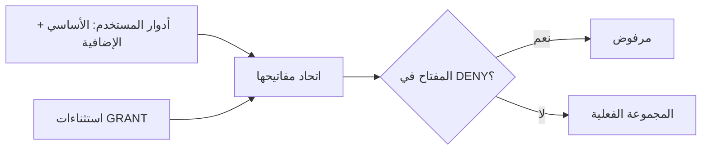

# ADR-02: نموذج الصلاحيات — مفتاح عرض لكل شاشة، واستثناءات على المستخدم، وأدوار الشركة السبعة

> الحالة: **مُقَرّ — أجاب المالك عن الأسئلة الأربعة وأقرّ التصميم في 2026-10-12 (القسم 8)** · التاريخ: 2026-10-12 · المنصة: منصة الطاقة (NPI)
> أعدّه الوكيل المعماري `erp-architect` بقراءة الكود (لا تشغيل). كل `ملف:سطر` أدناه على `feat/owner-changes-p1@f431ce3`. قُرئ الكود على `7cd6765` (كوده مطابق لـ`1a4d545` أساس `evidence/A2-nav-roles.md`)، ثم أُعيد فحص ما مسّته الالتزامات الثلاثة `8fe9cb9` و`aa28c01` و`f431ce3` التي دخلت الفرع أثناء الإعداد.
> تحققتُ بنفسي في الكود من: رسم القائمة و`can` وقراءة `/auth/me` مرة واحدة؛ `JwtStrategy` و`/auth/login` و`/auth/me`؛ الحارس؛ خدمة الإدارة وحارس الإقفال؛ محرر الأدوار ونموذج المستخدم؛ البذرة والترحيل 0021 و`deploy.sh`؛ مفاتيح المسارات (أُعيد استخراجها: 207 في ملفات المتحكمات، 12 منها لم تعد مسجَّلة بعد `8fe9cb9`)؛ `ApprovalService` والتفويض والإشعارات؛ طلبات كل صفحة مذكورة؛ ومواضع اعتماد مَدار على المفاتيح. أخذتُ من A2 دون إعادة حساب: مصفوفة الأدوار × الشاشات (§5.3–5.4).
> راجعت الجلسة الرئيسية بنفسها: أن طلبات الشاشات المحاسبية الثلاث منفصلة فعلاً (`apps/web/src/app/(app)/finance/page.tsx:84,94,98` · `statements/page.tsx:91-93` · `ledger/page.tsx:98,112`)، وأن قراءة طلبات الشراء على `scm.procurement.read` (`requisitions.controller.ts:29-30,44-45`)، وأن اختبار مَدار يثبّت الفهرس عند 40 مفتاحاً (`apps/copilot/tests/catalog.spec.ts:163-164`). وعدّلت نقطتين على المسودة: سبب الاستثناء اختياري لا إلزامي، وصفحة القوالب تعرض قواعد المصفوفة المقترحة للتطبيق بضغطة. ملاحظات التنفيذ بالإنجليزية في `evidence/A6-permissions-design-notes.md`.

## طلب المالك

«أريد شاشات المستخدمين تعرض فقط الأقسام المفوضين عليها، كي تكون الشاشة أبسط.» وقراراته في 2026-10-12 (`GAP_AR.md` §9 البند 2): الظهور والاختفاء تحكمه الصلاحيات بيد مدير النظام؛ صلاحية عرض مستقلة لكل شاشة في القائمة؛ «وللمستخدم بعينه زيادةً ونقصاً عن دوره، وكل تغيير يُسجَّل في التدقيق»؛ سبعة أدوار نقطةَ بداية ومستخدم بدور واحد؛ مهندس المشاريع يرى كل المشاريع وتقييد البيانات بحسب الإدارة مؤجل؛ الأثر يظهر في المتصفح المفتوح بلا إعادة دخول؛ ومعاينة «ماذا سيرى». خارج النطاق: إخفاء القسمين (نُفّذ في `8fe9cb9`)، والمال والمستندات المرحَّلة.

## 1. الحالة الراهنة

| الحقيقة | الدليل |
|---|---|
| القائمة والبحث السريع يرسمان الشاشة إذا غاب `perm` أو حمله المستخدم، و`can` مطابقة نصية بلا استثناء لمدير النظام. 20 شاشة مشروطة على 16 مفتاحاً: ثلاثة مفاتيح تفتح سبع شاشات | `apps/web/src/app/(app)/layout.tsx:119-122` · `apps/web/src/components/global-search.tsx:84` · `apps/web/src/lib/auth.tsx:85-88` · `apps/web/src/lib/nav.ts:28,31,41,42,60-62` |
| المجموعة الفعلية اتحاد الدور الأساسي والأدوار الإضافية، محسوبة بنسختين من الكود. الرمز يحمل `sub` و`org` فقط | `apps/api/src/modules/auth/jwt.strategy.ts:8-11,38-47` · `apps/api/src/modules/auth/auth.service.ts:19-25,61-64,86,131` |
| الخادم يعيد تحميل المستخدم وأدواره في كل طلب؛ المتصفح يقرأ `/auth/me` مرة عند التحميل | `jwt.strategy.ts:28-32` · `apps/web/src/lib/auth.tsx:44-65` |
| الحارس مغلق افتراضاً ويشترط **كل** المفاتيح المذكورة؛ لا صيغة «أيٌّ من» | `apps/api/src/common/guards/permissions.guard.ts:36-50` · `apps/api/src/common/decorators.ts:12-15` |
| لا شيء على المستخدم: لا عمود ولا جدول ولا حقل في DTO | `packages/db/prisma/schema.prisma:325-385` · `apps/api/src/modules/admin/dto.ts:16-77` |
| «مَن يحمل المفتاح؟» يُحسب في SQL من الأدوار وحدها في ثلاثة مواضع: حارس الإقفال، الإشعارات، فحص وجود معتمِد آخر للعرض | `apps/api/src/modules/admin/admin.service.ts:57-62,183-197,258-271,326-356` · `apps/api/src/common/notification.service.ts:113-136` · `apps/api/src/modules/commercial/proposals.service.ts:1026-1055` |
| التوقيع في المصفوفة يشترط معاً: مفتاح اعتماد المستند في صلاحيات الموقِّع الحية، ودور الخطوة (أساسياً أو إضافياً) أو تفويضاً يعيره، وأنه ليس الرافع، وأنه لم يوقّع خطوة سابقة. وحساب `canDecide` في صندوق الاعتمادات لا يفحص المفتاح | `apps/api/src/common/approval.service.ts:322-351,458-480` |
| بلا قاعدة تغطي المبلغ يعتمد رافع أمر الشراء مستنده بنفسه إن حمل `scm.procurement.approve`، ومثله المستخلص وأمر التغيير والعرض | `apps/api/src/modules/procurement/procurement.service.ts:275-285,306-310,1254-1260` · `apps/api/src/modules/projects/projects.service.ts:309-315` · `proposals.service.ts:540-547` |
| التفويض يعير الدور الأساسي للمفوِّض لخطوات الاعتماد فقط، وشرطه الوحيد على المفوِّض أنه نشط | `apps/api/src/common/delegation.service.ts:50-62` |
| تعديل الدور لا يفحص المصفوفة (الحذف يفحصها)، فسحب مفتاح اعتماد من دور موقِّع يوقف السلاسل عنده | `admin.service.ts:320-378,392-403` · `apps/api/src/modules/approvals/approvals.service.ts:212-235` |
| محرر الأدوار شبكة من فهرس الخادم صفوفها ليست شاشات القائمة؛ المستخدم الجديد يُختار له أول دور (مدير النظام)؛ الأدوار الإضافية خانات | `apps/web/src/app/(app)/admin/page.tsx:203-224,232,672-714,791-889` · `packages/shared/src/permissions.ts:135-188` · `admin.service.ts:275-281` · `packages/db/prisma/seed.ts:117` |
| صفحات تطلب قوائم بمفاتيح شاشات أخرى: `/procurement` ستة طلبات في `Promise.all` واحد يُسقطه رفض واحد، `/opportunities` تطلب العملاء، نموذج طلب الشراء يطلب `/items`، وزر «طلب جديد» بلا شرط | `apps/web/src/app/(app)/procurement/page.tsx:85-101` · `opportunities/page.tsx:54` · `requisitions/page.tsx:82,118` |
| المصفوفة المزروعة: طلب شراء ≥10,000 `pm`؛ أمر شراء ≥100,000 `pm` ثم `accountant`؛ مستخلص ≥250,000 `pm` ثم `accountant`؛ أمر تغيير ≥100,000 `pm` ثم `admin`؛ عرض من صفر `executive` | `seed.ts:685-692` |
| البذرة لا تعمل عند النشر؛ الترحيل يسبق تبديل الحاويات، والتبديل api ثم web ثم copilot. سابقة منح مفاتيح بترحيل بيانات | `deploy/deploy.sh:185-191,203-205` · `packages/db/prisma/migrations/0021_crm_roles_permissions/migration.sql:43-65` |
| مَدار: يعيد قراءة `/auth/me` كل 60 ثانية على الأكثر؛ يقرأ طلبات الشراء برمز المستخدم ويتحمل رفضها؛ يخزّن في قاعدته مفتاح مصدر كل معلومة؛ وتطبيق حزمة نشاط يكتب مجموعة صلاحيات الدور كاملة | `apps/copilot/src/auth/session.ts:23,297-313` · `apps/copilot/src/npi/client.ts:148,164` · `apps/copilot/src/queries/home.ts:109-120` · `apps/copilot/src/memory/npi-facts.ts:52-62` · `apps/copilot/src/onboarding/plan.ts:441-462` · `apps/copilot/src/onboarding/apply.ts:178-189` |
| لا مُشغِّل اختبارات في `apps/web` ولا `packages/shared`؛ الدوال المشتركة تُختبر من `apps/api` | `apps/web/package.json` · `packages/shared/package.json` · `apps/api/src/common/arabic.spec.ts` |

## 2. القرار

**صلبة (لا تُساوَم):**
1. الخادم هو السلطة. المجموعة الفعلية تُحسب بدالة واحدة: (اتحاد أدوار المستخدم ∪ `GRANT`) − `DENY`. الحجب يعلو كل منح، وما لم يُمنح ممنوع. لا قاعدة ضمنية أخرى داخل التقييم.
2. الاستثناء يمنح مفتاحاً ولا يمنح مقعداً في المصفوفة: التوقيع يبقى مشروطاً بدور الخطوة أو بتفويض، والرافع لا يعتمد.
3. كل تغيير في استثناء أو دور يُكتب في `AuditLog` داخل معاملة التغيير نفسها: مَن، لمَن، ماذا، قبل وبعد، والسبب إن كُتب.
4. لا تبقى المنشأة بلا مستخدم نشط يحمل `admin.user.manage` **فعلياً**؛ يُفحص بعد كل تعديل وداخل معاملته.
5. مفتاح عرض واحد لكل شاشة مشروطة، يُفرض باختبار. والمسار في الخادم يتبع مفتاح شاشته، لا الواجهة وحدها.
6. المفاتيح الثلاثة القديمة تبقى، كلٌّ مفتاحاً لشاشة واحدة. والجديدة تُمنح بترحيل لكل دور يحمل القديم: لا يتغير شيء لأي دور لحظة النشر.
7. الترحيل لا يغيّر اسم دور قائم ولا صلاحياته ولا إسناد مستخدم ولا قاعدة اعتماد. ذلك كله بضغطة من المالك بعد معاينة.
8. دور يوقّع في قاعدة اعتماد فعّالة أو في طلب اعتماد مفتوح لا يُسحب منه مفتاح اعتماد ذلك المستند.
9. قوائم الاختيار مسارات مستقلة بحقول دنيا، ولا مسار بلا تصريح صلاحية.

**مرنة:** الأسماء؛ ترتيب المهام 5–9؛ فترة التحديث (60 ثانية)؛ إبقاء حقل الأدوار الإضافية ظاهراً؛ إضافة تاريخ انتهاء للاستثناء؛ موضع القوالب في الواجهة؛ جعل سبب الاستثناء إلزامياً (اختياري الآن: مدير النظام شخص واحد، والحقل الإلزامي يُملأ بلا معنى).

## 3. التصميم

### 3-1 استثناءات المستخدم

```sql
PermissionEffect = GRANT | DENY
UserPermissionOverride(id, organizationId, userId → User ON DELETE CASCADE, permission, effect,
                       reason, createdById, createdAt)
  -- UNIQUE(userId, permission): المفتاح الواحد منحٌ أو حجب لا كلاهما · INDEX(organizationId, permission, effect)
```



| الموضع | اليوم | بعد القرار |
|---|---|---|
| `JwtStrategy.validate` (كل طلب) | اتحاد الأدوار `jwt.strategy.ts:38-47` | `effectivePermissions` تملأ `AuthUser.permissions`، فيرثها بلا تعديل: الحارس، محرك سير العمل، المصفوفة، البحث، المرفقات، حجب التكاليف |
| `/auth/login` و`/auth/me` | نسخة ثانية `auth.service.ts:19-25` | الدالة نفسها؛ شكل الاستجابة لا يتغير (مَدار والواجهة يقرآن `permissions`) |
| «مَن يحمل المفتاح؟» في SQL | من الأدوار | شرط واحد `holdsEffectively(key)` لحارس الإقفال والإشعارات و`hasOtherApprover` |
| الواجهة البرمجية | — | `GET` و`PUT /admin/users/:id/permissions` بـ`admin.user.manage`. `PUT` يستبدل المجموعة كاملة ويقبل سبباً اختيارياً، وسطر تدقيق واحد `PERMISSION_OVERRIDE` على `User` |

| التفاعل | الحكم |
|---|---|
| الأدوار الإضافية | تدخل الاتحاد قبل الاستثناءات والحجب يعلوها. تبقى في القاعدة والواجهة البرمجية لأنها مقعد ثانٍ في المصفوفة، ويختفي حقلها من نموذج المستخدم إلا لمن يحملها |
| التفويض المؤقت | المفوَّض يحتاج مفتاح الاعتماد فعلياً كما اليوم (`approval.service.ts:322-325`): المنح يكفيه والحجب يعطّله. يُضاف: تفويض من مفوِّض حُجب عنه المفتاح لا يُعير شيئاً |
| حارس الإقفال | حجب `admin.user.manage` عن آخر مدير، أو تعطيله، أو تغيير دوره، أو تعديل دور يُبقي المنشأة بلا مدير فعلي ← 400 |
| فصل المهام: ما يمنع | دور الخطوة، والرافع لا يعتمد، ولا توقيعان لشخص (`approval.service.ts:326-351`)؛ وطالب الشراء لا يعتمد طلبه ولو بلا سلسلة (`apps/api/src/modules/procurement/requisitions.service.ts:307-309`). فمنحُ مفتاح اعتماد لمستخدم لا يجعله معتمِداً لما رفعه |
| فصل المهام: ما لا يمنع | (1) بلا قاعدة تغطي المبلغ يعتمد الرافع مستنده إن جمع مفتاحَي الإنشاء والاعتماد. (2) أفعال تُحسم بمفتاح كتابة بلا فحص للمنشئ: اعتماد فاتورة المورد وسدادها `finance.payment.write`، قبول الاستلام `scm.procurement.write`، تفعيل العقد `commercial.contract.write` (يعالجه ADR-01). العلاج هنا: جدول `SOD_CONFLICTS` يحذّر المحررَين عند جمع زوج متعارض ويُسجَّل الإقرار في التدقيق، وقواعد اعتماد تبدأ من صفر (3-4) |
| تغيير دور المستخدم | لا يمسّ استثناءاته؛ يُنبَّه المدير لمراجعتها |
| صندوق الاعتمادات | `canDecide` يحترم المفتاح الفعلي، فلا يظهر زر لمن حُجب عنه |

### 3-2 فصل مفاتيح العرض الثلاثة

| المفتاح الجديد | شاشته | المسارات المنتقلة إليه | يبقى على القديم |
|---|---|---|---|
| `crm.task.read` «عرض مهام المتابعة» | `/tasks` | `GET /tasks` و`/tasks/summary` و`/tasks/:id` (`apps/api/src/modules/crm/follow-up-tasks.controller.ts:23-24,58-59,64-65`) وقسم المهام في صفحة العميل (`customers.service.ts:362-392`) | `crm.customer.read`: مسارات `/customers` الخمسة، `GET /activities`، البحث، المرفقات |
| `scm.requisition.read` «عرض طلبات الشراء» | `/requisitions` | `GET /requisitions` و`/requisitions/:id` (`apps/api/src/modules/procurement/requisitions.controller.ts:29-30,44-45`) | `scm.procurement.read`: الموردون وأوامر الشراء وعقود الباطن والمواقع والأرصدة (`procurement.controller.ts:24-25,37-38,43-44,145-146,170-171,176-177`) |
| `finance.report.read` «عرض التقارير المالية» | `/finance` | `GET /finance/reports/poc` و`vat-return` و`profitability` (`apps/api/src/modules/finance/reports.controller.ts:14-15,28-29,39-40`) | `finance.ledger.read` «عرض دفتر الأستاذ»: `trial-balance` و`general-ledger/:accountId` (`:46-47,75-76`) و`GET /finance/journal` و`/finance/retention` (`invoices.controller.ts:69-70,75-76`) |
| `finance.statement.read` «عرض القوائم المالية» | `/statements` | `income-statement` و`balance-sheet` (`reports.controller.ts:57-58,68-69`) و`GET /finance/fiscal/years` (`fiscal.controller.ts:14-15`) | |

```sql
UPDATE "Role" SET "permissions" = array_append("permissions", '<الجديد>')
WHERE '<القديم>' = ANY("permissions") AND NOT ('<الجديد>' = ANY("permissions"));  -- أربع مرات، كل المنشآت والأدوار
```

- **الفصل يستحق كلفته في الثلاثة:** 11 مساراً وقسم واحد في خدمة، وطلبات الشاشات المحاسبية الثلاث منفصلة أصلاً. لا مفتاح قراءة في `APPROVAL_DOCUMENTS` ولا في `wf_transitions` (`packages/shared/src/approvals.ts:35-80` · `seed.ts:783-895`)، فلا أثر على قواعد الاعتماد ولا سير العمل.
- **القديم لا يُحذف ولا يصير اسماً مستعاراً:** يبقى مفتاح شاشته. والأسماء الجديدة تحفظ بادئة الوحدة ولاحقة `.read`، لأن عمود الشبكة يُشتق من اللاحقة (`permissions.ts:109-118`) واكتشاف مَدار من البادئة (`apps/copilot/src/onboarding/discover.ts:125-134`).
- **مَدار:** لا تغيير في كوده ولا أدواته. قراءاته المفحوصة مسبقاً (العملاء، الموردون، أوامر الشراء) تبقى على مفاتيحها (`npi-facts.ts:52-57` · `apps/copilot/src/positions/handover-types.ts:27`)، وقراءة طلبات الشراء يحسمها خادم NPI. الذي يتغير بيانات: حُزَم النشاط الست `apps/copilot/catalog/profiles/*.json`، أدوار المنشآت التجريبية `packages/db/prisma/madar-scratch-orgs.ts:104-122`، واختبار يثبّت عدد المفاتيح عند 40 (`apps/copilot/tests/catalog.spec.ts:163-164`). بلا تحديث الحُزَم يسحب تطبيقُ حزمة المفاتيحَ الجديدة من أدوارها. **هذا انحراف عن حزمة مَدار الملزمة ويُسجَّل** في `PROGRESS.md` ← Deviations وفق `spec/madar/08-CLAUDE-CODE-KICKOFF.md` §E.1 و§E.5: مَدار يتكيف مع NPI، بلا مساس بقرارات `04` ولا بمخطط الحزمة (`spec/madar/02-TECH-SPEC.md:90`).

### 3-3 قوائم الاختيار

`GET /reference/lookups/{items,projects,customers,vendors,locations}` في المتحكم المرجعي القائم، بمزخرف جديد `@RequireAnyPermission` (يكفي مفتاح واحد من القائمة؛ والمسار بلا تصريح يبقى مرفوضاً). من يملك مفتاح العمل على الشاشة X ينال القوائم التي يحتاجها نموذجها، بأسمائها فقط، دون شاشة Y.

| القائمة | الحقول | يكفي أيٌّ من |
|---|---|---|
| `items` | المعرّف، الرمز، الاسم، الوحدة، متسلسل؟، `unitCost` (يُفرَّغ آلياً لمن لا يحمل `finance.costs.view`: `apps/api/src/app.module.ts:68`) | `commercial.item.read`، `scm.requisition.write`، `scm.procurement.write`، `commercial.proposal.write`، `fsm.workorder.write` |
| `projects` | المعرّف، الرمز، الاسم | `projects.project.read`، `scm.procurement.write` |
| `customers` | المعرّف، الرمز، الاسم | `crm.customer.read`، `crm.opportunity.write` |
| `vendors` | المعرّف، الرمز، الاسم | `scm.procurement.read`، `projects.project.write` |
| `locations` | المعرّف، الرمز، الاسم، النوع | `scm.procurement.read`، `assets.serialunit.read`، `fsm.workorder.write` |

الجدول ثابت واحد `LOOKUP_ACCESS` في `packages/shared` يقرؤه الحارس والواجهة. والصفحات تطلب كل قائمة في طلب مستقل ولا تطلبها إلا لمن يستحقها؛ غياب قائمة يعطّل حقلها ولا يُسقط الصفحة. حجب «عرض الأصناف» عن مستخدم لا يمنعه من اختيار صنف في طلب شراء؛ منعه بسحب صلاحية رفع الطلبات.

### 3-4 الأدوار السبعة ومصفوفة الاعتماد

إعادة تسمية في مكانها: `executive` «الإدارة العليا» ← «المدير العام»؛ `pm` «مدير مشاريع» ← «مدير عام المشاريع»؛ `site_engineer` «مهندس موقع» ← «مهندس المشاريع»؛ `accountant` يبقى «المحاسب». أدوار جديدة: `technical_office`، `finance_manager`، `warehouse_keeper`. لا يُمس `admin` (المالك، يحمل كل المفاتيح) ولا `sales`.
ع = مفتاح العرض، ت = `.write`، م = `.approve`. الشاشات الأربع العامة للجميع.

| الشاشة ← مفتاح عرضها | المدير العام `executive` | مدير عام المشاريع `pm` | المكتب الفني `technical_office` | مهندس المشاريع `site_engineer` | الإدارة المالية `finance_manager` | المحاسب `accountant` | أمين المستودع `warehouse_keeper` |
|---|---|---|---|---|---|---|---|
| العملاء المحتملون `crm.lead.read` | ع | ع ت | | | | | |
| العملاء `crm.customer.read` | ع | ع ت | | | | | |
| الفرص `crm.opportunity.read` | ع | ع ت | ع | | | | |
| مهام المتابعة `crm.task.read` | ع | ع | | | | | |
| العروض `commercial.proposal.read` | ع م | ع ت | ع ت | | | | |
| العقود `commercial.contract.read` | ع | ع ت | | | ع | | |
| المشاريع `projects.project.read` | ع م | ع ت | ع | ع ت | | | |
| طلبات الشراء `scm.requisition.read` | | ع م | | ع ت | ع | | |
| المشتريات `scm.procurement.read` | ع م | | ع ت⚠ | | ع ت | ع | ع ت⚠ |
| الأصناف `commercial.item.read` | | | ع ت | | | | ع |
| الفواتير `finance.invoice.read` | ع | | | | ع ت | | |
| مستحقات الموردين `finance.payment.read` | ع | | | | ع | ع ت | |
| التقارير المالية، القوائم المالية، دفتر الأستاذ | ع ع ع | | | | ع ع ع | | |
| خاصة | `finance.costs.view`، مرفقات عرضاً | `finance.costs.view`، مرفقات | `finance.costs.view`، مرفقات | مرفقات | `finance.costs.view`، `finance.period.manage`، مرفقات | — | — |
| شاشات القائمة من 24 | 17 | 12 | 9 | 6 | 12 | 6 | 6 |

- «م» في صفَّي طلبات الشراء والمشتريات مفتاح واحد `scm.procurement.approve`؛ مَن يوقّع ماذا تحدده المصفوفة لا المفتاح.
- ⚠ الاستلام والتحويل يتطلبان اليوم `scm.procurement.write` الذي يسمح أيضاً بإنشاء مورد ومسودة أمر شراء (السؤال 3).
- أُضيف على جدول المالك لضرورة العمل: عرض «المشتريات» للمدير العام ليراجع أمر الشراء قبل اعتماده، وعرض «طلبات الشراء» للإدارة المالية لتحوّل الطلب المعتمد إلى أمر شراء.
- لا يجمع أي دور من السبعة مفتاحَي إنشاء واعتماد لمستند واحد، ولا إنشاء مورد وسداده. نتيجته الملزمة: **كل مستند يحتاج قاعدة تبدأ من صفر**، وإلا تعذّر اعتماد ما دون الحد إلا على مدير النظام.

| المستند | اليوم (`seed.ts:685-692`) | دورة الشركة (`GAP_AR.md` §4) | المطلوب في المصفوفة |
|---|---|---|---|
| طلب شراء | ≥10,000: `pm`. دونه بلا سلسلة | يعتمده مدير عام المشاريع | من صفر: `pm` |
| أمر شراء | ≥100,000: `pm` ثم `accountant`. دونه يعتمده رافعه إن حمل مفتاح الاعتماد | تصدره الإدارة المالية ويعتمده المدير العام | من صفر: `executive` |
| عرض سعر | من صفر: `executive` | يعتمده المدير العام | بلا تغيير |
| مستخلص مقاول | ≥250,000: `pm` ثم `accountant` | غير مذكور | من صفر: `pm` ثم `executive` (السؤال 4) |
| أمر تغيير | ≥100,000: `pm` ثم `admin` | غير مذكور | من صفر: `executive` (السؤال 4) |

**خطة التطبيق، بلا ترحيل للأدوار:**
- القوالب السبعة ثابت `ROLE_PRESETS` في `packages/shared`. `GET /admin/role-presets` يعرض لكل قالب: يُنشأ أو مطابق أو مختلف، الفرق (+/−)، الاسم الحالي والمقترح، عدد المستخدمين المتأثرين، وسبب المنع إن وُجد. `POST /admin/role-presets/:key/apply` يطبّق قالباً واحداً عبر `createRole` و`updateRole` القائمتين (تدقيق وحرّاس).
- متكرر بلا أثر: التطبيق الثاني فرقه فارغ. آمن على خادم عُدّلت أدواره: لا يُمس دور لم يختره المالك، والفرق يُعرض قبل الضغط.
- المستخدمون: لا نقل آلي ولا حذف لدور إضافي. يُسند المالك لكل مستخدم دوراً واحداً من نموذجه.
- الترتيب يفرضه الحارس 8: إنشاء الأدوار الجديدة وإعادة التسمية ← تعديل القواعد الخمس من شاشة المصفوفة ← تضييق `pm` و`accountant` و`executive` و`site_engineer` ← إسناد المستخدمين. وصفحة القوالب تعرض القواعد الخمس المقترحة بالترتيب نفسه لتُطبَّق بضغطة عبر خدمة المصفوفة القائمة، كي لا يُترك المالك لتعديلها يدوياً.

### 3-5 الأثر الحي، والشاشات الأربع العامة

- `AuthProvider` يعيد قراءة `/auth/me`: كل 60 ثانية والتبويب ظاهر، وعند عودة التبويب إلى الواجهة، وفور أي 403 من أي طلب (حدث يطلقه `apiFetch`)، وبعد حفظ المدير دوراً أو استثناءً. يُحدَّث السياق فقط إذا تغيّرت القائمة.
- حارس صفحة في `(app)/layout.tsx`: أطول بادئة للمسار في سجل الشاشات؛ إن غاب مفتاح العرض تُعرض «هذه الشاشة غير مفعّلة لحسابك» بدل الصفحة وبدل بطاقة الخطأ الحمراء.
- لا تغيير في الخادم. أقصى تأخير 60 ثانية لتبويب خامل، وصفر عند أول نقرة على ما سُحب؛ المنع نفسه فوري في الخادم. ومَدار يلتقط التغيير خلال 60 ثانية بآليته (`session.ts:23`).
- **الشاشات الأربع تبقى بلا مفاتيح** وتُجمع في مجموعة أولى «عام»: لوحة المعلومات صفحة الهبوط وكل بطاقة فيها محكومة بمفتاح بياناتها؛ صندوق المهام والاعتمادات مقيَّدان في الخادم بدور الطالب نفسه (`apps/api/src/modules/approvals/approvals.controller.ts:77-87,107-115`)، وحجبهما يخفي عن الشخص التزاماته ويوقف السلاسل؛ ومَدار تطبيق مستقل بجلسته، فمفتاح على رابطه إخفاء بلا منع.

### 3-6 محرر الأدوار، محرر المستخدم، والمعاينة

- **سجل شاشات واحد** `packages/shared/src/screens.ts` (المجموعة، المسار، مفتاح العرض)؛ `nav.ts` يقرأ منه ويضيف الأيقونة ومفتاح الترجمة. `PermissionMeta` يكتسب `screen` و`action` صريحاً. `GET /admin/permissions` يبقى مصفوفة مسطحة بحقوله الحالية، لأن مَدار يقرأ منها `key` و`groupAr` و`labelAr` (`apps/copilot/src/npi/permissions.ts:39-58`).
- **الشبكة:** صف لكل شاشة في القائمة باسمها وترتيبها، والأعمدة عرض، إنشاء وتعديل، اعتماد. الشاشات الأربع العامة صفوف ثابتة «للجميع». المفاتيح الخاصة المرتبطة بشاشة تظهر تحت صفها (دمج العملاء، إقفال الفترات، ولاحقاً `commercial.contract_clause.write` تحت العقود و`commercial.contract.approve` في عمود اعتمادها)، والباقي في «صلاحيات خاصة» ومنه `admin.contract_template.manage`. إطفاء «عرض» يطفئ بقية الصف في المحرر.
- **المعاينة:** الدالة `visibleScreens(permissions)` نفسها ترسم القائمة الحقيقية والبحث السريع ومعاينة المحررَين، فلا تنحرف المعاينة عن الواقع. في محرر الدور تُحسب من الخانات قبل الحفظ؛ وفي محرر المستخدم من `effectivePermissions(أدواره، المسودة)`، مع عدّاد «سيرى N شاشة من 24».
- **محرر استثناءات المستخدم:** الشبكة نفسها بالقيمة الفعلية. الخانة المخالفة للدور تُوسم «مضاف» أو «محجوب» ولها «إرجاع إلى الدور»؛ حقل السبب اختياري؛ تحذير تعارض المهام يظهر قبل الحفظ. قائمة المستخدمين تعرض شارة مثل «+2 −1».

## 4. البدائل المرفوضة

| القرار | البديل | سبب الرفض |
|---|---|---|
| أ | عمودا منح وحجب على `User` | لا مَن ولا متى ولا لماذا لكل استثناء إلا بالتنقيب في سجل التدقيق، ولا مكان لانتهاء مؤقت لاحقاً، ومنع التناقض يحتاج قيداً إضافياً |
| أ | دور خاص لكل مستخدم مستثنى | يكثّر الأدوار، ويغيّر مقاعد المصفوفة والإشعارات لأنها بالدور |
| أ | سقوط التعديل والاعتماد تلقائياً بسقوط العرض داخل التقييم | يغيّر سلوك أدوار قائمة عند النشر (الرفع بلا عرض إعداد مشروع، ومَدار يستعمله)، ويضع قاعدة ضمنية داخل الحارس |
| ب | مفاتيح شاشات للواجهة فقط مع مفتاح بيانات مشترك (للشاشات المحاسبية) | إخفاء بلا منع: المسار يبقى مفتوحاً لمن سُحبت منه الشاشة. والفصل الحقيقي ستة مسارات لا يستدعيها مَدار |
| ب | القديم مظلة تتضمن الجديد، أو إعادة تسمية القديم | المظلة تُبقي خانة واحدة لشاشتين؛ وإعادة التسمية تُبطل ما خزّنه مَدار من مفاتيح المصادر وما في حُزَمه |
| ج | منح عرض الشاشة Y لكل من يحتاج قائمتها | هو سبب الازدحام الأول اليوم |
| ج | مفاتيح `lookup` على المسارات الكاملة | تكشف سجلات كاملة (هواتف العملاء، قيم المشاريع) لمن يحتاج الاسم، وتضيف مفاتيح لا معنى لها عند المالك |
| ج | الاكتفاء بتحمّل الصفحة غياب القائمة | نموذج طلب شراء بلا أصناف لا يُنشئ طلباً |
| د | ترحيل يعيد كتابة الأدوار الستة والمصفوفة | يسحب شاشات من مستخدمين قائمين لحظة النشر ويدوس تعديلات المالك |
| د | جعل `accountant` «الإدارة المالية» لأنه الأوسع اليوم | المفتاح دائم وظاهر في الشاشة، وشخصية مَدار تتبعه؛ الأسلم أن يبقى مفتاح المحاسب للمحاسب |
| د | فصل مفتاح كتابة للمستودع الآن | يمس انتقالات محضر الاستلام وأمر الشراء في `wf_transitions` (`seed.ts:816-819,834-836`) ومسار مَدار للاستلام؛ مكانه الحزمة 4 مع شاشات الاستلام |
| هـ | بثّ من الخادم، أو بصمة صلاحيات في رأس الاستجابة | الأول بنية جديدة لحدث نادر؛ الثاني يحتاج تعديل CORS (`apps/api/src/main.ts:66-70`) واعتراضاً في الطرفين، والاستطلاع يكفي |
| ز | مفاتيح للشاشات الأربع | تخفي عن الشخص التزاماته، وتترك من سُحبت منه لوحة المعلومات بلا صفحة هبوط |

## 5. التبعات

- لا تغيّر ظاهراً لأي مستخدم عند النشر حتى يضغط المالك. الكلفة الدائمة: قراءة إضافية لكل طلب، وطلب `/auth/me` كل دقيقة لكل تبويب مفتوح (تقدير لا قياس).
- بين الترحيل وتبديل الحاويات، وبعد أي تراجع إلى صورة سابقة، يرفض الكود القديم حفظ دور يحمل مفتاحاً جديداً (`admin.service.ts:283-290`) حتى يُشغَّل `down.sql`.
- السلاسل المفتوحة تبقى على أدوار خطواتها الأصلية لأن الخطوات تُنسخ عند الرفع (`approval.service.ts:221-223`): تُنهى قبل تضييق الأدوار، وإلا منع الحارس 8 التضييق.
- تطبيق حزمة نشاط من مَدار لاحقاً يدوس أدوار الشركة، إلا في وضع الاكتشاف حيث لا يمس دوراً قائماً (`plan.ts:413-427`).
- مسارا مَدار لطلب الشراء وأمره يقرآن `/items` و`/projects` الكاملين، فتتعطل مطابقتهما لمن ضُيّق دوره حتى المهمة 10. قالبا المهندس والإدارة المالية يُطبَّقان بعدها إن كان أصحابهما يعملون عبر مَدار.
- «الاستلام» يبقى تحت `scm.procurement.write` حتى الحزمة 4.
- مهمة متابعة قد تُسند اليوم لمن لا يملك شاشتها (`follow-up-tasks.controller.ts:51-55` · `apps/api/src/modules/inbox/inbox.service.ts:134-176`): تُقصر قائمة المكلَّفين على حاملي `crm.task.read`.
- لا شيء هنا يمنع تقييد البيانات بحسب الإدارة لاحقاً: التقييم دالة مفاتيح فقط، والنطاق محور مستقل يُفرض في الاستعلامات، ومنها قوائم الاختيار.

## 6. المهام والترحيلات

| # | المهمة (التزام واحد) | يعتمد | الحجم | الترحيل | يُختبر |
|---|---|---|---|---|---|
| 1 | تعديلات الواجهة الصغيرة: مجموعة «عام» أولاً؛ شريط مسار المبيعات خلف `crm.lead.read` (`dashboard/page.tsx:186-202`)؛ نموذج المستخدم الجديد بلا دور مختار (`admin/page.tsx:232`)؛ زر «طلب جديد» خلف `scm.requisition.write` | — | صغير | — | بدورَي المحاسب والمهندس: لا مجموعة فارغة ولا شريط مبيعات؛ حفظ مستخدم بلا اختيار دور مرفوض |
| 2 | سجل الشاشات و`visibleScreens` و`effectivePermissions` في `packages/shared`؛ `nav.ts` يقرأ منه؛ `screen` و`action` في الفهرس | — | صغير | — | كل شاشة مشروطة لها مفتاح موجود؛ قائمة استثناء صريحة بالمفاتيح الثلاثة المشتركة تُفرَّغ في المهمة 4؛ `GET /admin/permissions` مصفوفة بحقولها السابقة |
| 3 | قوائم الاختيار و`@RequireAnyPermission`؛ الصفحات تطلب كل قائمة مستقلة وتتحمل غيابها | — | متوسط | — | بلا مفتاح من القائمة ← 403، ومسار بلا تصريح ← 403؛ الحقول المسموحة فقط و`unitCost` فارغ بلا `finance.costs.view`؛ حامل `scm.procurement.read` وحده تُحمَّل له `/procurement` بلا بطاقة خطأ؛ رافع طلب بلا `commercial.item.read` يختار صنفاً |
| 4 | فصل المفاتيح: الأربعة الجديدة، 11 مساراً، قسم مهام العميل، القائمة ولوحة المعلومات وتبويبا العميل والفرصة، البذرة، ومعها حُزَم مَدار الست و`madar-scratch-orgs.ts` واختبار عدد المفاتيح | 2 | متوسط | ترحيل بيانات (المنح الأربعة) مع `down.sql` | لكل دور مزروع ولكل دور في حُزَم مَدار: الشاشات والمسارات المتاحة قبل الترحيل = بعده؛ حامل القديم وحده يُرفض على الشاشة المفصولة والعكس؛ لا مفتاح عرض لشاشتين؛ الترحيل مرتين = مرة؛ بوابتا مَدار خضراوان |
| 5 | الاستثناءات في الخادم: الجدول، الدالة الواحدة في المواضع الثلاثة، `holdsEffectively`، مسارا `GET` و`PUT`، التدقيق، الحرّاس (الإقفال، خطوة المصفوفة، التفويض)، `canDecide` | 2 | كبير | جدول `UserPermissionOverride` | الحجب يعلو الدور الأساسي والإضافي والمنح؛ بلا استثناءات النتيجة مطابقة لليوم؛ `validate` و`login` و`me` متطابقة؛ مفتاح محجوب ← 403 وانتقال سير العمل يختفي؛ ممنوح مفتاح الاعتماد خارج دور الخطوة ← 403، والرافع ← 403؛ حجب `admin.user.manage` عن آخر مدير ← 400 من مساراته الأربعة؛ سطر تدقيق واحد لكل حفظ داخل المعاملة؛ المحجوب لا يُشعَر؛ مستخدم منشأة أخرى ← 404 |
| 6 | الأثر الحي وإشعار «غير مفعّلة لحسابك» | 2 | صغير | — | بمتصفحين: السحب يُخفي الشاشة خلال دقيقة أو عند أول نقرة، والصفحة المفتوحة تصير إشعاراً هادئاً؛ المنح يُظهرها |
| 7 | محرر الأدوار: صف لكل شاشة، معاينة القائمة، تحذير `SOD_CONFLICTS` | 2، 4 | متوسط | — | صفوف الشبكة = عناصر القائمة بترتيبها؛ المعاينة = القائمة الفعلية بعد الحفظ لكل دور مزروع؛ إطفاء «عرض» يطفئ الصف؛ سحب مفتاح اعتماد من دور موقِّع ← رسالة تسمّي القاعدة |
| 8 | محرر استثناءات المستخدم ومعاينة «ماذا سيرى»، الشارة، وإخفاء حقل الأدوار الإضافية | 5، 7 | متوسط | — | مدير غير تقني يحجب شاشة عن مستخدم ويضيف أخرى ويرى المعاينة، ثم تطابقها قائمة ذلك المستخدم؛ السطر يظهر في تبويب التدقيق |
| 9 | قوالب الأدوار السبعة: الفرق والتطبيق قالباً قالباً، ومعها القواعد الخمس المقترحة للمصفوفة بضغطة | 3، 4، 7 | متوسط | — | التطبيق مرتين = فرق فارغ؛ لا يُمس دور غير مختار ولا `admin`؛ يُمنع ما يكسر الحارسين 4 و8؛ كل تطبيق في التدقيق؛ بعده مسح الأدوار السبعة بلا بطاقة خطأ |
| 10 | مواءمة مَدار (مهمة مَدار تُسجَّل انحرافاً): قراءاته المرجعية عبر قوائم الاختيار، ومراجعة نصوص الشخصيات | 3 | صغير | — | مسار طلب الشراء لمهندس بلا `commercial.item.read` يطابق الأصناف |

أرقام الترحيلات تُحدَّد عند التنفيذ (آخر ترحيل على الفرع `0029`). اختبار القبول العام عبر مهارة `npi-erp-testing`: فحص الصلاحيات لكل دور مقابل قائمته، ومسح المتصفح لكل شاشة بكل دور.

## 7. أحكام

- العمل على `feat/owner-changes-p1` لأنه نواة النظام؛ وكل ما يمس `apps/copilot` يُسجَّل انحرافاً في `PROGRESS.md`.
- `accountant` يبقى للمحاسب و`finance_manager` جديد (مرن حتى أول تطبيق للقوالب). `sales` يبقى غير مسند ولا يُحذف. لا قالب لـ`admin`.
- «التشغيل والصيانة» و«الأصول المتسلسلة» لا يراهما أي دور من السبعة: لمدير النظام وحده حتى تُبنى شاشات التنفيذ.
- لا مفتاح كتابة جديداً في هذه الحزمة: مهام المتابعة تُكتب بـ`crm.customer.write`، والاستلام بـ`scm.procurement.write`.
- أدوار البذرة الستة تبقى كما هي وتكتسب المفاتيح الأربعة بقاعدة الترحيل نفسها، لأن اختبارات مَدار ومهارة الاختبار تعتمد عليها. أدوار الشركة مصدرها القوالب.
- مدير النظام يرى كل شيء بالمنح لا بتجاوز في الكود. وكل ترحيل يضيف مفتاحاً لاحقاً، ومنه مفاتيح ADR-01 الثلاثة، يمنحه لدور `admin` ويضيفه إلى القوالب وجدول التعارض.
- الاستثناء الذي صار بلا أثر بعد تعديل الدور يبقى ويُعرض «بلا أثر حالياً» مع زر إزالة.

## 8. أسئلة حسمها المالك (2026-10-12)

اختار الموصى به في الأربعة، ثم أقرّ التصميم ليبدأ بناؤه:

1. **اعتماد طلب الشراء وأمر الشراء:** من صفر ريال. مدير عام المشاريع (`pm`) يعتمد كل طلب شراء، والمدير العام (`executive`) يعتمد كل أمر شراء، ويرى لذلك شاشة «المشتريات». رُفض: حدّ مالي بين الاثنين لأمر الشراء، وإبقاء حدّي اليوم (10,000 و100,000).
2. **السداد للموردين:** المحاسب (`accountant`) وحده يعتمد فاتورة المورد ويسددها، والإدارة المالية (`finance_manager`) تطّلع فقط. رُفض: أن تسدد الإدارة المالية أيضاً.
3. **الاستلام والتحويل:** تُمنح `scm.procurement.write` لأمين المستودع والمكتب الفني الآن، مع علمه أنها تسمح مؤقتاً بإنشاء مورد ومسودة أمر شراء لا تمضي بلا اعتماد؛ وتُفصل صلاحية المستودع مع شاشات الاستلام في الحزمة 4. رُفض: العرض فقط حتى الحزمة 4.
4. **مستخلص مقاول الباطن وأمر التغيير:** من صفر ريال. المستخلص يوقّعه مدير عام المشاريع ثم المدير العام، وأمر التغيير يوقّعه المدير العام. رُفض: إبقاء حدّي اليوم (250,000 و100,000).

وقرّر معها أن **تُنشر الحزمة 1 دفعة واحدة بعد اكتمالها**، لا مهامها الثلاث الأولى وحدها.

## 9. غير متحقَّق

قاعدة البيانات الحية: الأدوار الموجودة فعلاً وما عُدّل منها، أدوار المستخدمين الحقيقيين وأدوارهم الإضافية، قواعد الاعتماد المطبّقة، وهل طُبّقت عليها حزمة من مَدار. لم يُشغَّل شيء: لا اختبار ولا متصفح، وسلوك الواجهة كله من قراءة الكود. نصوص شخصيات مَدار الخمس وملاءمتها للأدوار بعد إعادة التسمية، وسلوك مساراته حين تُرفض قراءة الأصناف أو المشاريع. توجيه `/copilot` في الإنتاج وقيم `NEXT_PUBLIC_API_URL` و`CORS_ORIGINS` على الخادم. مصفوفة A2 للأدوار × الشاشات لم يُعَد حسابها. سلوك طلب شراء دون الحد يرفعه من لا يحمل مفتاح الاعتماد (من قراءة `requisitions.service.ts:399-415`). حمل الاستطلاع الدوري تقدير لا قياس.
